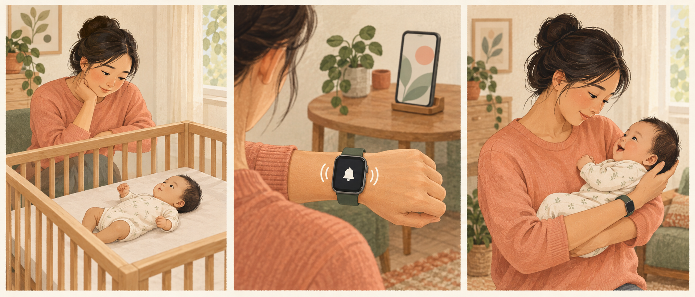

# Baby Signal · 宝宝信号

[简体中文](README.md) · **English**

**Turn a baby's cries into a reminder a caregiver can see and feel.**

An open-source iPhone + Apple Watch engineering prototype for deaf and hard-of-hearing caregivers. It explores reusing devices a household already owns: analyze sound locally on the phone, then provide visual status and a wrist alert.

> **Important limitation: the Apple built-in classifier stops working after the test device locks. Do not rely on this version for overnight or unattended monitoring.** A successful build, test alarm or foreground recovery does not demonstrate reliable crying detection, all-night background operation or waking a sleeping caregiver. We publish failures and verification boundaries alongside the code.



*This fictional illustration was generated with Codex. It represents the motivation and concept, not the people in the original video or a proven product outcome.*

## Why this project exists

The idea came from a video about a deaf mother caring for her child and a comment describing a challenge: a caregiver who cannot hear crying may need to watch their baby more frequently.

Many everyday alerts assume that the recipient can hear. Could a baby's sound become a wrist reminder, giving a mother information she can act on by checking and caring for her baby in person?

We have not independently verified the people or circumstances in the video, collaborated with them, or completed target-user research. Public materials do not reproduce their faces, usernames, location, private messages, health details or family information. Read the [project story](docs/story.en.md).

## Product approach

**Phone near the baby → local candidate crying detection → consecutive-result confirmation → system alarm → paired watch alert → caregiver checks baby → monitoring continues or is resumed.**

- **Reduce additional cost.** Reuse an iPhone and paired Apple Watch without a server. These devices are not affordable to everyone; lower-cost implementations are welcome.
- **Provide clear ways to perceive alerts.** Combine illustrations, short text, large buttons and tactile reminders. Do not communicate essential status through sound or color alone.
- **Keep household audio private.** Microphone audio is not saved or uploaded. Events and limited diagnostics remain on the phone.
- **Leave decisions to the caregiver.** A crying event prompts someone to check the baby. It does not identify hunger, pain, breathing problems or illness.
- **Show truthful status.** Explain interruptions; claim recovery only after valid analysis returns. Stopping an alert and stopping a monitoring session are separate actions.

See the [product and technical design](docs/product-design.en.md).

## Current implementation and evidence

| Capability | Implementation and boundary |
|---|---|
| Local crying classification | Apple SoundAnalysis `baby_crying`; classification fails after the test device locks. The real crying-to-alert loop has not passed verification. |
| System alarm and watch alert | AlarmKit is implemented. A participant confirmed a watch vibration in one test alarm; delivery reliability and waking a sleeping wearer are unproven. |
| Dynamic Island and Lock Screen | ActivityKit + WidgetKit are implemented. Compact status was inspected and a participant confirmed a Lock Screen card. These do not keep audio processing alive. |
| Automatic and quick recovery | An ended alarm can trigger recovery. The app provides a resume action; valid foreground analysis has been observed. Background limitations remain. |
| Illustrated interface | Warm colors, three-step pictures, large buttons and system font scaling. Full VoiceOver and large-text coverage are incomplete. |
| Earlier CPU experiment | One locked test-alarm recovery worked, but the short crying fixture did not pass consecutive confirmation. It is excluded from the current build and is not an accuracy benchmark. |

**Scheduling an alarm, triggering it, reaching a watch, being perceived, and waking someone require separate verification.** There is no independent watchOS app or measured accuracy/reliability guarantee.

## Get the code and install

```bash
git clone https://github.com/zhangjianle0836-netizen/baby-signal.git
cd baby-signal
open BabySignal.xcodeproj
```

Requirements: a Mac, Xcode with the required iOS SDK, and an iPhone running iOS 26.0 or later. Builds have been tested with Xcode 27.0 and an iPhone 14 Pro running iOS 27.0.1. A participant reported a Series 6 watch running watchOS 26.6; its complete version was not independently read. Pair and verify your own watch.

1. Sign into your own Apple development account in Xcode.
2. Copy `Config/Signing.local.xcconfig.example` to `Config/Signing.local.xcconfig` and enter your Team ID. Do not commit it. Alternatively, select your team in Signing & Capabilities for both targets.
3. Choose unique bundle identifiers for the app and extension, such as `com.yourname.babysignal` and `com.yourname.babysignal.liveactivity`. The extension identifier must use the app identifier as its prefix.
4. Connect and unlock the iPhone, complete trust and Developer Mode prompts, select the `BabySignal` scheme and real device, then run.
5. Allow microphone and alarm access. Test watch vibration away from a resting baby; follow the instructions to lock the phone and check actual perception.
6. Use monitoring for engineering tests only. If it stops, open the app and select **Resume monitoring**; wait for valid analysis.

Personal device development testing does not require App Store publication. Free Personal Team signing typically needs renewal every seven days; capabilities and behavior must be verified on your account and hardware. [Apple account documentation](https://developer.apple.com/help/account/basics/about-your-developer-account)

## App language

The app and Live Activity extension include **Simplified Chinese and English**. They follow the iPhone's supported system/app language. Where iOS offers an app-language setting, select it in iPhone Settings → Apps → Baby Signal → Language; otherwise adjust the preferred language list. Reopen the app after changing language. Unsupported languages fall back to English.

This covers buttons, status, illustrated guidance, history labels, accessibility labels, permission prompts and app alarm text. Apple Watch system screens follow watch settings. Fixed historical descriptions are translated for display without rewriting records; original system-generated error details retain the language supplied by iOS.

Already scheduled alarms may retain the text created when they were scheduled. End them and create a new test after changing language. Changing language does not fix locked-screen detection.

## Local checks

```bash
./scripts/verify.sh tests
./scripts/verify.sh build                 # unsigned iPhone build
./scripts/verify.sh all                   # sequential tests and build
./scripts/verify.sh device YOUR_DEVICE_ID # local device/signing only
```

The script uses a single-instance lock and at most two build jobs. Do not bypass a live lock or run duplicate verification commands. Build outputs, private signing configuration, certificates, audio, logs and Xcode user state are excluded from Git.

72 checks have passed, including localization behavior and five real built-in-classifier silence windows. These are not crying accuracy tests. See the [device checklist](docs/device-test-checklist.en.md).

## Contributions most needed

1. Separate capture, classification and recovery diagnostics; resolve classification failure after locking.
2. Validate a system Sound Recognition → Shortcuts → app alert action alternative. It is proposed, not implemented.
3. Evaluate local CPU detection with independent lawful positive and negative samples: missed events, false alerts, latency and power.
4. Repeat locked crying → watch alert → dismissal → next detection before longer trials.
5. Co-design accessible interactions with deaf caregivers and investigate affordable phones and wrist devices.

[Contribution guide](CONTRIBUTING.en.md) · [Fork](https://github.com/zhangjianle0836-netizen/baby-signal/fork). You may modify and redistribute the code under its license; changing models, thresholds or devices requires fresh validation.

## Care and privacy boundaries

This is an assistive engineering experiment. No alert does not mean a baby is safe. Never make a baby cry for a test. Keep the phone and cables outside the crib and out of reach; do not cover the phone. Maintain existing care arrangements during trials.

Power loss, force quit, reboot, a crash, lost connection or changed permissions may prevent any warning. A status card or one successful vibration is not reliability evidence.

Do not publish identifiable baby images/audio, chat screenshots, medical information, contact details, location, device identifiers or signing data. [Privacy](docs/privacy.en.md)

## Code and experiment notes

- `BabySignal/Core/`: detection, recovery and shared activity state.
- `BabySignal/Services/`: audio capture/classification, AlarmKit, ActivityKit and persistence.
- `BabySignal/MonitorStore.swift`: permissions, sessions, events and recovery.
- `BabySignal/Views/`: monitoring, guidance, settings and history.
- `BabySignalLiveActivity/`: Dynamic Island and Lock Screen views.
- `Shared/Localization/`: shared Chinese/English interface resources.
- `Tests/` and `scripts/`: simulator-free checks and resource-limited builds.

[Recovery evidence](docs/alarm-recovery.en.md) · [Quick recovery](docs/quick-resume.en.md) · [Live Activities](docs/live-activity.en.md) · [Visuals](docs/visual-design.en.md)

## License and acknowledgments

Original code and documentation use the [MIT License](LICENSE). The earlier YAMNet model retains Apache-2.0 terms. See [third-party and media notices](THIRD_PARTY_NOTICES.en.md).

We thank the video and comment that inspired this idea, and everyone sharing accessible-care experience and test results. This repository does not identify or imply endorsement by the original people. It offers a starting point others can inspect and improve.
