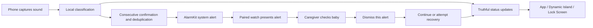

# Product and technical design

[简体中文](product-design.md) · **English**

## Purpose and scope

Provide deaf caregivers with baby-cry information they may not perceive through sound, prompting them to check in person. Reuse available phones/watches without a server or cloud audio upload.

The app does not diagnose the reason for crying or assess health. Locked-screen detection and the real crying-to-alert loop have not met acceptance criteria.

## Information flow

This is an architecture diagram, not evidence that every step works reliably. Scheduling is not delivery or perception.

## Components

| Component | Role | Boundary |
|---|---|---|
| AVAudioEngine | Microphone capture and lifecycle | A running engine is not proof of valid classification |
| SoundAnalysis | Built-in `baby_crying` candidate scores | Fails after the test device locks; its compute device is not explicitly controlled |
| CryEventGate | Consecutive results, quiet reset and repeated-event interval | Prototype thresholds are not accuracy guarantees |
| MonitoringRecovery | User intent, bounded retries and recovery confirmation | Only valid analysis confirms recovery; explicit stop does not auto-start |
| AlarmKit | Schedule, cancel and observe alarms | Cannot prove watch delivery or waking someone |
| ActivityKit / WidgetKit | Status, expiration and app entry | Does not keep capture alive; display updates are system-scheduled |
| EventRepository | Events and user receipt confirmation | Stores no audio; timestamps may reveal usage patterns |
| L10n and shared resources | Chinese/English UI in app and extension | Original iOS error descriptions may remain in their original language |

## Interaction principles

Use pictures with short text and large controls. Do not rely only on color or sound. End one alert separately from stopping a session. Preserve the recovery-action location while reconnecting. Show resumed status only when valid analysis returns. Stale or unknown status asks the user to check; no crying event is not a safety assessment.

## Proposed directions—not verified features

**System recognition bridge:** test iPhone accessibility Sound Recognition while locked, then Shortcuts sound triggers, App Intents and alarms. Public trigger APIs exist; the complete flow is neither implemented nor verified. Without access to recognition health, the app must not claim it knows the system is actively listening.

**Controllable local models:** choose CPU-only inference and validate resampling, audio features, outputs and event rules. The earlier YAMNet experiment is a starting point; lowering a threshold to pass one clip is not validation.

**Affordable devices:** investigate phones plus wristbands, local-network links or other tactile endpoints. Define disconnection, power, permission and repeat-alert acceptance criteria before choosing a platform.

## Meaningful verification

Measure capture continuity, classification output, event formation, alarm triggering, watch receipt, user perception and the next detection after dismissal separately. Use independent lawful samples to evaluate misses, false alerts, latency and power. Begin with daytime tests and maintain existing care arrangements.

## References

[SoundAnalysis](https://developer.apple.com/documentation/soundanalysis/snclassifysoundrequest) · [Core ML compute units](https://developer.apple.com/documentation/coreml/mlcomputeunits) · [Similar lock-screen failure](https://developer.apple.com/forums/thread/811582) · [System Sound Recognition](https://support.apple.com/guide/iphone/iphf2dc33312/ios) · [Shortcuts triggers](https://support.apple.com/guide/shortcuts/event-triggers-apd932ff833f/ios) · [AlarmKit](https://developer.apple.com/videos/play/wwdc2025/230/)
